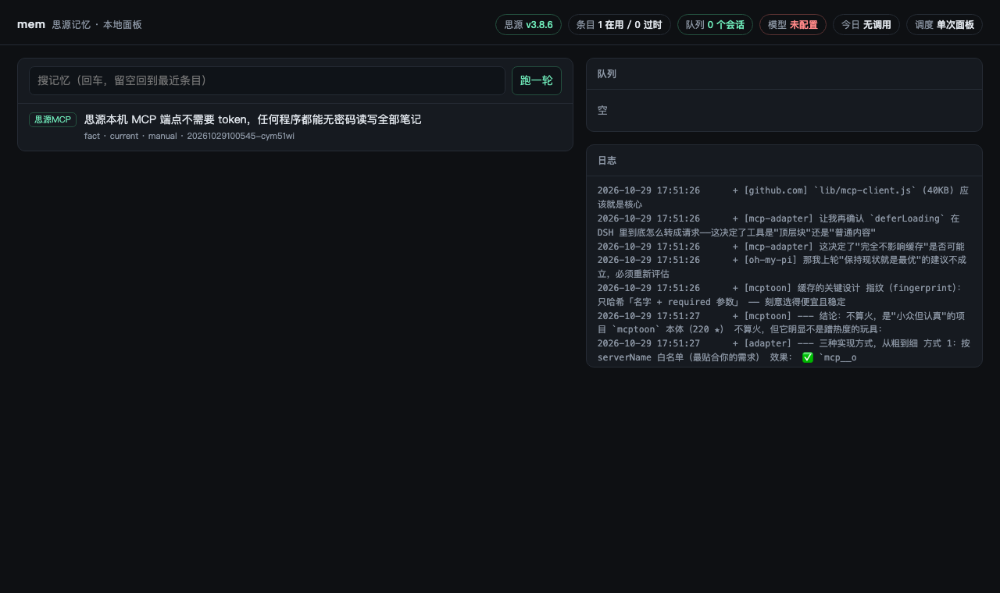

# siyuan-mem

把 harness 会话变成思源笔记里的记忆条目。

不是又一个记忆框架。它只补思源没有的那一块：**采集、抽取、状态**。
存储、索引、展示、双链、SQL 全是思源自己的，一行没重写。

## 它做什么

```
各 harness 会话日志 ┐
                    ├─▶ inbox ──mem serve──▶ 思源（90-记忆）
其他机器的 mem push ─┘   ▲                      │
                        └── agent/pre-step 注入 ◀┘
```

三件事：

- **采集**：插件把用户说的话和模型说的话投进本地队列，`mem serve` 每十分钟扫一遍其余四家的日志补上。thinking、工具调用、自己注入的上下文全部丢掉。
- **抽取**：把一段会话压成几条带实体名的结论，写进思源，挂上状态属性。
- **注入**：开会话时，插件查一次思源，把可能相关的既有结论贴进上下文。查不到就跳过，不阻塞对话。

## 为什么是思源

因为它已经给了你六样东西，自己写全是最烦的部分：块级稳定 id、任意自定义属性、属性视图、双链反链、SQL、全文索引。
它缺的四样——事务、向量、调度、版本——本来也不该由存储层负责。

## 安装

需要 Node 20+，思源 3.8+ 在跑。

```bash
cd ~/Codes/siyuan-mem
cp config.example.json ~/.siyuan-mem/config.json   # 首次运行也会自动生成
node src/cli.mjs init
```

`init` 会建一个 `90-记忆` 笔记本和三个文档（`01-条目` 当目录用，下面按月份分 `/2026-10`；`02-实体`；`03-实体待确认`）。

想直接敲 `mem`：编一个自带运行时的单文件，再软链进 PATH。

```bash
npm run dist                                   # 产物在 ~/.siyuan-mem/mem，86MB
ln -sf ~/.siyuan-mem/mem ~/.local/bin/mem      # 确认 ~/.local/bin 在 PATH 里
mem status
```

`~/.siyuan-mem/mem` 是**发版产物**，运行时焊死在里面（当前 bun 1.4.4）。改了代码要重新 `npm run dist`，否则跑的还是旧的。

`ingest-log` 记住每个日志读到第几行（`~/.siyuan-mem/offsets.json`），重复跑只投新增部分；文件被重写或轮转（变小）就从零开始。

想让它抽取质量好一点，填 `config.json` 里的 `model.apiKey`。不填也能跑，走规则抽取，只是结论糙。

## 用法

```bash
node src/cli.mjs status              # 连通性、条目数、队列长度、服务在不在
node src/cli.mjs once                # 处理队列（--dry 先看要写什么）
node src/cli.mjs serve               # 常驻：每轮找新会话 → 投队列 → 写思源
node src/cli.mjs serve --once        # 只跑一轮（给 launchd 定时用）
node src/cli.mjs search 风盾500       # 查
node src/cli.mjs search --all 风盾500 # 连已过时的一起查
node src/cli.mjs scan                # 本机有哪些 harness 的会话，各多少
node src/cli.mjs scan --all          # 全读一遍，数轮数和字数
node src/cli.mjs audit               # 对账：收了多少字、丢了多少字、为什么丢
node src/cli.mjs audit --all         # 全部会话的对账表
node src/cli.mjs review 20           # 最近 20 条，人工扫一眼
node src/cli.mjs remember "..." --entity 思源MCP --type fact
node src/cli.mjs forget <块id>        # 标成过时，不删
node src/cli.mjs show <块id>          # 看这条结论对应的原文（按指针回读附件）
node src/cli.mjs raw list             # 原文归档了哪些 part
node src/cli.mjs entity               # 实体表
node src/cli.mjs entity review        # 执行 03-实体待确认 里勾选的项
node src/cli.mjs model list qwen     # 目录里的 provider / 某家的模型（带价格）
node src/cli.mjs model refresh       # 刷新 models.dev 目录
node src/cli.mjs ui                  # 本地面板 127.0.0.1:7787
node src/cli.mjs service install     # 装成 launchd 服务
node src/cli.mjs center setup        # 把本机设成中心（开接收端、生成 token）
node src/cli.mjs push --to URL --token T --save   # 边缘机器：推到中心
```

软链到 PATH 之后就是 `mem status`、`mem once`。

## 一台机器，还是中心 + 边缘

单机时 `mem serve` 就够了，下面这些都不用管。多机时要有中心：**思源在哪台机器上，mem 就装在哪台**。抽取要模型 key、要写同一份库，这两件事一旦分散，key 就有 N 份、prompt 就有 N 份、token 账就有 N 本。

```
边缘 A ─┐  mem push（本机日志 → turns，只推新增）
边缘 B ─┼──────────────▶  中心：mem serve
边缘 C ─┘                   ├─ 接收端 7788（token 鉴权 → 队列）
                            ├─ 抽取 + 写思源（唯一写入方）
                            └─ 面板 7787（只读，仅回环）
```

- **边缘只读日志、只发请求**：不碰模型、不碰思源，所以那台机器上只需要一个可执行文件和一个地址。
- **中心独占抽取**：key 一份、prompt 一份、用量账一本、重试只在一个地方发生。
- **推送是增量的**：边缘按自己的 offsets 记"读到第几轮"，中心按内容哈希判重。边缘重装丢了 offsets 会重推，但不会写两遍。

```bash
# 中心（和思源同一台机器）
mem center setup --port 7788      # 开接收端、生成 token、打印边缘要跑的那条命令
mem service install               # 常驻；接收端跟着 serve 一起起

# 边缘
mem push --to https://mem.example.com --token <token> --save --test
mem push --watch                  # 常态：每 2 分钟推一次
mem push --once --all             # 首次回灌：一次推完，不等安静 180 秒
```

几个必须知道的：

- **只推"安静了 3 分钟"的会话**。正在写的会话切出来全是半句话。`--quiet 0` 可以关掉这个等待，首次回灌常用。
- **token 必须有**。接收端是写入通道，没 token 又绑 `0.0.0.0` 会直接拒绝启动。公网请走 HTTPS 反向代理（Caddy 两行、nginx 三行）；面板仍然只绑 `127.0.0.1`，远程看用 `ssh -L 7787:127.0.0.1:7787`。
- **每条记忆带 `custom-mem-machine`**。多机汇聚之后，这是唯一能分清"这条来自工作电脑还是家里"的字段。
- **offsets 按机器分组**（`machines.<主机名>.<路径>`）。三台 Mac 的路径长得一模一样，不分开就会互相顶掉。
- **思源在 Docker 里时，mem 装在宿主机**，`baseUrl` 填映射出来的端口（默认 `127.0.0.1:6806`）。别把 mem 塞进思源容器：容器重建一次它就没了，而且它要读的是宿主机上的会话日志。

## 一个字都不截

采集侧不做任何截断。走到抽取的每一段都是用户真说的话或模型真说的话——那是唯一不可再生的语料，截断是不可逆的有损压缩，写的时候丢掉的东西，读的时候任何模型都救不回来。

长内容靠**拆批**解决，不靠砍：

- 按字符预算（默认 16000 字/次）把会话切成若干批，逐批调用模型，批与批独立；
- 一条问答本身就超预算时，按段落把它切开分别送，所有段拼起来等于原文；
- 各批结果按内容去重后合并，超出单会话上限的条数会打印出来，不静默丢弃；
- 会话内再走一次**语义收敛**：同一件事被前后几轮各总结一遍的，只留信息最全的那条；
- 入库前跟库里同话题的条目**判重**（`dedupe.mjs`）：先挑候选，再让模型判
  `covered`（不写）/ `replace`（写新的，旧的标 superseded）/ `keep`（照写）；
  判重失败或拿不准一律照写——重复一条是脏，丢一条是错；
- 模型调用失败退回规则抽取时，**原文留在队列里不归档**，等模型恢复重跑。

被过滤掉的只有四类，它们都不是对话内容：thinking、工具调用与结果、上下文压缩的摘要块（`cb_summary` 等，会伪装成用户消息）、插件自己注入的记忆。

实测：一个 1013 轮、26 万字符的真实会话 → 360 个问答对、17 批，字符数分毫不差。

| 配置项 | 默认 | 作用 |
|---|---|---|
| `extract.maxCharsPerCall` | 16000 | 一次模型调用的字符预算，超了拆批 |
| `extract.maxEntriesPerBatch` | 8 | 每批最多出几条（超了会算进 dropped，不静默丢） |
| `extract.maxEntriesPerSession` | 自适应 | 一个会话最多入库几条，默认按批数 ×4 夹在 8-36 之间；写死数字会盖掉自适应 |
| `extract.minTurnChars` | 25 | 短于这个且两边都短的寒暄直接跳过 |

## 判重怎么挑候选

这一步只影响「把哪几条送去让模型判」，是不是重复一直由模型判断。

**只有字面，按字二元组覆盖率 ≥0.15 取前 10 条。** 就这一行。

为什么不上向量和重排序——都试过，都撤了：

| 方案 | 召回（旧语料 82 查 / 179 处重复） | 召回（新语料 200 字口径） |
|---|---|---|
| 字面 6 条 | 87% | — |
| 字面 10 条 | 99% | 100% |
| 向量 10 条（bge-m3 嵌 brief） | 85% | 27% |
| 重排序（bge-reranker-v2-m3） | 判不了 | 判不了 |

两个结论：

1. **收益全在「多给几个位置」上，不在「换成语义」上**。6 条提到 10 条，召回 87%→99%，
   一次嵌入调用都不需要。
2. **条目变长之后，字面反而更强**。200 字一条时同话题配对的余弦中位数只有 0.49，
   真重复和不相干的邻居挤在同一个区间；而长文本共享的字二元组多，覆盖率区分度很高。
   向量 10 条在新语料上只捞到 27%，不如字面的 100%。

重排序模型是另一回事：它算的是「相不相关」，同话题条目天然高相关，重复对中位 0.999、
不重复对中位 0.981，分布几乎完全重叠，做不了判断，连排候选都排不出顺序。

所以这套依赖（嵌入接口、本地向量表、`mem embed` 命令）已经整条移除。将来真需要语义召回，
先看这份数字再决定要不要加回来。

## 模型接口

三种协议，一个接口。调用方只给 `messages`，拿 `{text, usage}`，不知道对面是谁：

| 协议 | 端点 | 用于 | system 放哪 | JSON 模式 | 默认 temperature |
|---|---|---|---|---|---|
| `openai` | `/chat/completions` | DeepSeek、通义、Kimi、智谱、OpenRouter、ollama、LM Studio | messages 里 | `response_format` | 0.2 |
| `anthropic` | `/v1/messages` | Claude | 顶层字段 | 无（靠提示词） | 0.2 |
| `gemini` | `/models/{m}:generateContent` | Gemini | `systemInstruction` | `responseMimeType` | **1.0** |

Gemini 那 1.0 是官方的建议：Gemini 3 调低温度反而会退化、循环。三家各按各的规矩来，不强行统一。

分工是三层，别混：`src/wire/*.mjs` 只负责"这种协议怎么拼请求、怎么读回复"；`src/llm.mjs` 管策略（重试、JSON 回退、记账、预设）；调用方只关心文本和 token。

为什么 OpenAI 那家走官方 SDK、另两家手写：SDK 只对同一种形状有收益，而且它零传递依赖、纯 JS，编进单文件只多 1MB。Anthropic / Gemini 的差异太大（system 顶层、模型名在路径里、角色叫 `model`、token 字段名不同），各自五六十行写完更好审，也不用为两家每年会 breaking 的 SDK 付维护费。三者都懒加载。

预设十家：`deepseek / qwen / moonshot / zhipu / openai / openrouter / anthropic / gemini / ollama / lmstudio`（本地两家不要 key）。自定义端点用 `model.wire` 指定协议。

### 模型目录（抄 OpenCode 的做法）

预设里的模型名会过期，这不是假设：写这份文档时 `deepseek-chat` 已经下架，目录里现在是 `deepseek-v4-flash / v4-pro`；`moonshot-v1-32k` 换成了 `kimi-k3`。所以 provider 和模型元数据不自己维护，直接读 [models.dev](https://models.dev)（OpenCode 用的同一份）：233 家、8909 个模型，带价格、上下文长度、环境变量名。

```bash
mem model refresh            # 拉一份到 ~/.siyuan-mem/models.json（7 天自动过期）
mem model list qwen          # 列 provider；给的是某一家就列它下面的模型（带价格）
mem model                    # 当前模型的单价、上下文、目录日期
```

只抄它的**数据**，不抄它的**技术栈**。OpenCode 用 `npm` 字段去挑 SDK；我们是按同一个字段反推协议（`@ai-sdk/anthropic*` → anthropic，`@ai-sdk/google*` → gemini，其余 openai 兼容），请求还是自己那三个 wire 发。pi-ai（`@mariozechner/pi-ai`）走的是另一条路——每个协议装一个官方 SDK，连 Bedrock、Mistral 的 SDK 一起打包，实测 104 个包、132MB `node_modules`，编译时还会因为少一个 `@opentelemetry/api` 直接失败。我们只有一种调用形状，为一张表背这些重量不划算。

目录还带来两个附带好处：配置里没写 key 时会去读 provider 对应的环境变量（`DEEPSEEK_API_KEY` 之类）；模型名不在目录里时 `mem model` 会提示"可能是旧名"。

**"有没有模型"只有一处判断**：`hasModel(cfg)` —— 它认三种情况：config 里写了 key、key 来自环境变量、provider 本身 keyless（ollama / LM Studio）。启动检查、抽取、实体归一都用它。

这条是补的窟窿：抽取层原来自己判 `Boolean(cfg.model?.apiKey)`，只认写在 config 里的那一份。于是 keyless 和"key 在环境变量里"这两种情况会在启动时说"模型没问题"、抽取时一条条走规则——`mode=heuristic`，写进库全是半句话，看起来像"这场对话本来就没内容"。现在规则是：**判定只许调 `hasModel`，不许自己翻 `cfg.model`**。

```bash
mem model                                            # provider、协议、地址、模型、key（打码）、今日用量
mem model use anthropic --key sk-ant-... --name claude-sonnet-4-6
mem model use gemini --key AIza... --name gemini-3.5-flash
mem model use deepseek --key sk-... --wire openai    # 自定义端点也可以显式指定协议
mem model test                                       # 真发一次请求，自证 key、地址、JSON 模式、记账都通
```

三件 SDK 替不掉、必须自己做的事：

- **JSON 模式回退**：服务端不认 `response_format`（或 `responseMimeType`）会回 400。这时去掉该字段重发一次，并标记 `fallback`——不让整段会话因此降级成规则抽取。prompt 相应要求顶层是对象 `{"entries":[…]}`。
- **按调用打 tag 的用量账本**：`~/.siyuan-mem/usage.jsonl` 记 model / wire / tag / tokens / 耗时，`mem status` 显示今日汇总，`serve` 每轮日志带 tokens。回灌一百多个会话时，这是唯一能判断"还要不要继续跑"的指标。**缓存命中的 token 单独记**（OpenAI 的 `prompt_tokens_details.cached_tokens`、Anthropic 的 `cache_read_input_tokens`、Gemini 的 `cachedContentTokenCount`）——缓存价便宜一个数量级，混在输入里会让成本估算虚高一截。
- **统一的重试策略**：429/408/409/5xx 退避重试（认 `retry-after`），4xx 其余立刻抛。放在策略层而不是各家 adapter 里，这样"试了几次"在三种协议之间才可比。

`npm test` 用本地假接口测九条：429 重试（真的等了 `Retry-After`）、`response_format` 被拒后回退、401 不重试、5xx 重试到上限、Anthropic 的请求形状与解析、Gemini 的路径与角色映射、预设映射、抽取整链、记账可读。不发真请求、不花钱，跑完不碰真实 `usage.jsonl`。

## 数据结构

三个文档，各管一件事：

| 文档 | 放什么 | 谁写 |
|---|---|---|
| `01-条目` | 按「日期 · 项目」分二级标题，一条记忆一个列表项；标题上挂原文附件链接 | 抽取 |
| `02-实体` | 话题 → 条目摘要 → 块引用，纯视图，随时可重建 | `mem entity reindex` |
| `03-实体待确认` | 三态任务列表，人勾选 | 人 + worker 读 |

一条记忆 = `01-条目` 里的一个段落块 + 十一个属性：

| 属性 | 值 |
|---|---|
| `custom-mem-status` | `current` / `superseded` |
| `custom-mem-entity` | 话题，如 `风盾500`（已归一） |
| `custom-mem-brief` | 30 字以内的结论摘要，`02-实体` 里的锚文本用它 |
| `custom-mem-type` | `decision` / `fact` / `preference` / `reference` |
| `custom-mem-hash` | 内容哈希，用来去重 |
| `custom-mem-source` | 哪个 harness 产生的 |
| `custom-mem-session` | 会话 id |
| `custom-mem-date` | 写入日期 |
| `custom-mem-confidence` | 1–5 |
| `custom-mem-machine` | 哪台机器上产生的 |
| `custom-mem-raw` | 原文指针：`assets/…jsonl#120-180` |

状态只有两种。**过时的不删**——"为什么当初不用 Oracle"这个问题的答案，就在那条被取代的条目里。被取代的条目还会记 `superseded-by` / `superseded-at`，链是通的。

## 原文归档

结论要能追回原话。存法是**思源附件**，不是笔记正文：

- 附件不进 `blocks_fts`。正文里的对话会把「风盾」的 IDF 稀释掉——搜结论时先蹦出一堆「你说的是风盾500吗」，这就是原文进正文的代价。
- 代价是附件会被「清理未引用资源」扫到。所以每个 part 都必须在某个块的正文里被链接一次——
  `01-条目` 的分组标题就是那个锚点，那不是装饰，是保活用的。
- 存**规范化后的轮次**，不是原始日志：原始日志 227MB，规范化后 7.5MB，差 30 倍。差额是 thinking、工具调用、注入的上下文——本来就不进记忆，而且工具结果里可能有 key。

格式是 JSONL，一行一轮，首行 meta：

```
{"type":"session","v":1,"machine":"Mac","harness":"workbuddy","session":"…","from":1,"to":180,"chars":61234,"hash":"…"}
{"i":1,"role":"user","text":"…"}
{"i":2,"role":"assistant","text":"…"}
```

选它的理由只有一个：**行就是地址**。第 120 轮到第 180 轮顺序读过去就停，不用解析全文；坏一行不连累别的；`grep` 直接命中。md 做不到（没有稳定行地址，AI 想找第 120 轮只能整份解析）。

### 指针

```
custom-mem-raw = "assets/mem-raw/Mac/workbuddy/xxx.p1-20261029234242-8shd81c.jsonl#120-180"
```

物理路径 + 轮次范围。**不用块 id + 逻辑轮次**，因为物理路径指向一个写进去就不再变的文件：日志被重写、重新切分、附件改名，都不会让指针错位。轮次号按每行的 `i` 字段比，不按行号——行号会随 meta 行和分片头变。

附件不能追加，所以长会话按**推送批次**切成多个 part，一个 part 一个新文件，永不重写。首次回灌一个超长会话时，单包超过 8MB 会在轮次边界再切，绝不切一行。

传一半失败是可以续的：切分只跟 turns 和字节预算有关，跟"已经传过什么"无关，所以重试会切出
一模一样的分段——已经传过的那几段直接跳过、不重传（重传会得到内容重叠的两份附件，指针说不清
指哪份）。返回里那些跳过段带 `reused: true`，调用方照样能用它们算指针。

「哪些区间已经传过」只记在本地 `raw-index.json`（键是 `机器|harness|会话`，值是 `{path, from, to}`）。以前还有一条兜底：回思源查带 `custom-mem-kind="raw-part"` 的块——但那种块早就不写了（链接挂在分组标题上），那条路永远返回空，`mem raw list` 因此一直显示"还没有归档过原文"。现在兜底删掉、命令改读索引。代价说清楚：**索引丢了就不知道传过什么**，下次增量会重传（附件不覆盖，只多出重复文件），不丢内容但会脏。`mem raw list` 能看到账本长什么样。

`mem show <块id>` 读指针、取回附件、只渲染那几十轮，默认截到 8000 字。

## 实体归一

模型给的 entity 是自由的，同一款裤子会变成「风盾500」「风盾 500」「京造风盾500」。检索取的是 entity 字段，名字一散，查一个漏两个。

三道闸，从便宜到贵：

1. **抽取时带清单**：把已有实体（连同别名）塞进 prompt，让模型优先复用。几百个实体三千 token，一批多花这点钱换的是源头不产生新名字。
2. **本地字符串匹配**：包含关系、编辑距离、最长公共子串。零成本，吃掉绝大多数变体。
3. **弱候选问一次模型**：只回答下标 `{"same":[0,3]}`，一次判二三十对；判过 diff 的记进否定表，以后不再问。

**型号后缀不自动合并。** `风盾500` 和 `风盾500pro` 字面上只差三个字母，但 pro/max/mini 一般是另一个 SKU。这类进 `03-实体待确认`，人看一眼。

### 话题收敛：一个东西和一类东西不是一回事

每轮跑完，把全部话题名连同各话题下两三条摘要一起交给模型，问哪些该合并。

2026-10 全量重跑后出过一次严重误合：`mcp-adapter`（一个具体项目）被并进了
「DSH MCP 插件生态」（它装进去的宿主生态），于是 68 条实现细节全躺在叫「生态」的桶里，
而真正是同一个东西两种叫法的「mcp-adapter」和「MCP 网关架构」反倒分了家。66 条里
只有 4 条真的是 DSH 自己的插件机制。

根因在 prompt：原来写着「合并的代价是以后要记两个名字，所以宁可多合一点」，而且
只给名字不给内容——模型看不出哪边是项目、哪边是生态，只看到两个都提 MCP。

现在三条：

- 判据是「把两个名字分别填进『我要查 ___ 怎么做的』」。问的是同一件事才合并；
  一句的范围明显包住另一句，就是粒度错，不合。
- 名字后面挂两三条摘要当证据。不给摘要，「mcp-adapter」和「DSH MCP 插件生态」
  在字面上就是一大一小两个名字，看不出前者桶里装的其实是后者。
- 拿不准就不合。合并是单向的，错合之后没人知道当初为什么合。

另一个分界值得记住：**收敛只管名字，不管内容**。如果一个话题的桶里装的其实是
另一个东西，该做的是把条目的 `custom-mem-entity` 改挂过去，不是合并两个名字——
后者只会让名字变得更不像里面装的东西。

### 待确认是显式三态

思源只有 `[ ]` 和 `[X]` 两种任务状态（`[x]` 会被内核存成大写），**没有打叉**。所以否定必须写出来，不能靠"不勾"或"删行"推断——那样三天后你自己也分不清是判过了还是没处理。

```markdown
## 待确认

- [ ] 风盾500pro ← 风盾500      ← 不动 = 继续待确认
- [ ] UTO 速干衣 ← UTO 滑雪内搭

## 已否定
```

- `[X]` = 合并（在思源里点一下方块就行，手机上最顺手）
- `[-]` = 不是同一个，写进否定表，以后不再问
- 整行无论怎么写，解析时按块 id 定位，不按行号

**勾选之后的合并是纯机械操作，不调模型**：你勾选的时候已经做完判断了。worker 只做三件事——把名字记进别名、把条目的 entity 改成规范名（一次批量接口）、把源实体标成 merged。

顺序是「先写表，再改条目」：表是真相，条目属性是派生物，中途失败可以从表重放。

## 五家 harness，一份读取器

核心（抽取、存储、查询、状态）**跟 harness 无关**，一行没绑定。绑不住的只有"怎么拿到会话"。

| harness | 会话日志 | 接法 | 限制 |
|---|---|---|---|
| WorkBuddy | `~/.workbuddy/projects/*/*.jsonl` | 读日志（无插件机制） | 闭源，拿不到进程内事件 |
| Qoder | `~/.qoder/projects/*/*.jsonl` | 读日志 | 格式照抄 Claude Code |
| OMP | `~/.omp/agent/sessions/*/*.jsonl` | 读日志 | 子代理转录在会话目录下一层，要跳过 |
| DSH | `~/.dsh/sessions/*/*/session.v4.jsonl.zstd` | cordis 插件，或读日志兜底 | 多帧 zstd |
| Claude Code | `~/.claude/projects/*/*.jsonl` | hook 脚本，或读日志 | 子代理标 `isSidechain` |

采集层分两条路：能装插件的（DSH、Claude Code）走进程内钩子，其余读日志。

读取分两层：**共用引擎 + 每家一份声明**。

`readers/base.mjs` 是引擎——解压、找消息节点、role 归一、注入块、子代理回报、逐块对账。`readers/<harness>.mjs` 只声明差异，每个十几到几十行：WorkBuddy 的 `<function_call>` 前缀、Qoder 的 `origin.kind`、OMP 的 `attribution`、DSH 的 `plugin:` 和 `delegationDepth`、Claude 的 `isSidechain`。`readers/index.mjs` 是注册表。

为什么不全塞进一个通用函数：试过，四家在 105 个会话上逐字节一致，但那是"读文本"一致；各家特有的**过滤规则**混进共用代码之后，改一家的规则会波及另外三家。现在升级或排障只看一个文件。新增一家是写一份声明，不是抄一遍解析循环——`readers/generic.mjs` 就是零声明的样子。

格式细节、各家的坑和实测数字在 [`docs/harness-会话格式横向对比.md`](docs/harness-会话格式横向对比.md)。

日志这条路还有个附带好处：插件截获会漏、会崩、会重复，日志是 append-only 的，harness 自己不会写丢。插件挂了，日志还在。

```bash
mem ingest-log ~/.workbuddy/projects/<ws>/<session>.jsonl
mem ingest-log ~/.omp/agent/sessions/<slug>/<file>.jsonl
mem ingest-log ~/.dsh/sessions/<ws>/<sid>/session.v4.jsonl.zstd
```

格式按内容嗅探（只影响来源标签，不影响解析）。用户消息里的 `<system-reminder>`、`<cb_summary>` 摘要块、子代理事件、工具结果会在读取时剔掉。

剔掉的不等于丢掉了——`mem audit` 会把每个块归到"收进语料 / 思考块 / 工具结果 / 注入与摘要 / 其它"，五类相加等于日志里全部消息文字。本机 105 个会话的对账结果是 2585 万字里 355 万进语料，**"其它"为 0**，即没有一个字下落不明。

**子代理的处理要分两半**：它自己的转录整份不读（OMP 放在会话目录下一层，Claude 标 `isSidechain`，DSH 标 `delegationDepth`）；但它的**结论**会回到主线——OMP 是 `job` 工具结果里的 `<task-result>`，Claude Code 是 `Task` 工具的 `tool_result`——这一份必须收，否则丢的是结论。本机这样捞回 64 段、12.3 万字。"Spawned agent…"这类派发回执会被过滤掉。

## DSH 插件

`plugin/` 是一个 cordis 插件，装到 profile 里：

```bash
cd ~/Codes/siyuan-mem/plugin
npm link                     # 或 pnpm link --global
dsh plugin --profile desktop add dsh-siyuan-memory
dsh --profile desktop --dump-config   # 确认它出现在配置树里
```

它只做两件事：`session/event` 攒文本、`session/flush` 写队列；`agent/pre-step` 注入一次。
没有界面、没有右键菜单、没有侧边栏——远程和 headless 的会话一视同仁。

**思源没开也安全**：注入超时 800ms 就放弃，采集只写本地文件。

## 常驻：锁、节奏、退避

`mem serve` 就是"每十分钟自己跑一轮"，但只写个定时循环会踩三个坑，所以它多做三件事。

**锁。** 思源没有行级合并，两个进程同时写同一份文档，后写的整块覆盖先写的。锁用 `O_EXCL` 建 `~/.siyuan-mem/serve.lock`，靠内核保证只有一个进程能建成，不靠"先查再写"那种有竞态的判断。持锁进程被 `kill -9` 或断电时锁会留在磁盘上，所以启动时先看 `process.kill(pid, 0)`：进程不在了就接管并打印一行，还在就报错退出（确认是僵尸再加 `--force`）。锁里记 host，换台机器或重启之后 pid 不可信。`mem once` 也走同一把锁，服务在跑时手动跑会被拒。

**节奏。** 正在写的会话不能切：每十分钟切一刀，切出来全是半句话。所以只投"安静了 180 秒"的会话（`serve.quietSeconds`）。另外只读**体积变过**的文件——本机 105 个会话共 500MB，每轮全解析一遍纯属浪费，而 `stat` 是微秒级的，体积没变不可能出新内容。每轮最多投 8 个（`serve.maxSessionsPerRound`），第一次启动不会把 105 个会话一次塞给模型，剩下的每轮接着投。

**退避。** 思源没开、模型 429 的时候不要连着重试。失败后第一次等 1 分钟，之后翻倍，最多 30 分钟；成功一次就归零。一轮的顺序也是固定的：**先探思源活着没有，再看有没有新会话，最后才调模型**——反过来，思源一天没开，模型的钱就白花一天，因为抽出来的东西写不进去，下轮还得重抽。

**单飞。** 进程锁挡的是"第二个进程"，挡不住同一个进程里的两条流。面板上点「跑一轮」走的是另一个入口，和定时那一轮各跑各的 `processQueue`，会同时往同一批块上 append、同时改 supersede 标记——思源没有行级合并，撞上去不报错，只表现为"偶尔有条目写了一半"或"旧条目永远停在 current"。所以在 `serve` 里加了一道进程内互斥：谁先来谁跑，后来者拿到 409 和一句"有一轮正在跑（定时，已 12 秒）"，面板据此把按钮灰掉。定时轮撞上时不算失败、不退避，记一行"跳过"就等下一轮。

日志在 `~/.siyuan-mem/serve.log`，超过 2MB 轮转成 `.1`，每轮一行：

```
2026-10-29 15:06:37  启动 pid 14444，每 10 分钟一轮
2026-10-29 15:06:40  投递 qoder  312 轮  ~/.qoder/projects/.../c276c7b5.jsonl
2026-10-29 15:06:40  第 1 轮 4.0s：思源 v3.8.6，扫描 105 个会话，新投 2 个（697 轮），写入 33 条，跳过 0，失败 0
```

`Ctrl-C` 会跑完当前这一轮再退，退的时候还锁；再按一次直接退出。`kill -9` 也不会把队列搞乱——归档是 `rename`，要么发生要么没发生。

## 服务与面板

### 装成系统服务

```bash
mem service            # 看状态：plist 在不在、launchctl 里有没有、最近一行日志
mem service install    # 常驻（KeepAlive，崩溃后 30 秒重试）
mem service install --interval 10   # 或者定时：每 10 分钟跑一次 serve --once
mem service uninstall
mem service unit       # Linux：打印 systemd 单元，不落盘
```

plist 里的可执行文件优先指向 `~/.siyuan-mem/mem`（用 bun 编出来的单文件，自带运行时），其次退回 mise 的 node shim。**不要信 `which node`**——它只反映当前 shell 的 PATH 顺序，而 launchd 的 PATH 只有 `/usr/bin:/bin:/usr/sbin:/sbin`。这台机器上排第一的是 WorkBuddy 自带的那份，写进 plist 就是给别的软件的升级绑定。

两个坑在代码里处理了：

- **`launchctl` 的退出码不可信**：`load` 装失败也返回 0，只在 stderr 打一句 `Load failed: 5`。所以装完必须回查一次 `launchctl print`，否则会谎报成功。
- **配置错的时候不要每 30 秒撞一次墙**：没配 `model.apiKey` 时 `serve` 会干净退出（exit 0），`KeepAlive` 只对失败重启，所以不会热循环。配好之后 `mem service install` 再装一次，或 `launchctl kickstart -k gui/$(id -u)/com.siyuan.mem`。

在沙箱/无 GUI 会话里 `bootstrap` 会报 `Bootstrap failed: 5: Input/output error`，这是环境限制不是 plist 的问题——换到普通终端执行那条命令即可。

### 面板

`mem serve` 起来时顺带在 `127.0.0.1:7787` 开一个面板（`mem ui` 可以单独开）。看状态、翻最近条目、看队列和日志尾部，点一下能跑一轮。



只有 127.0.0.1，**没有鉴权**，所以绝不绑 `0.0.0.0`——局域网上任何设备都能读你的记忆库。总共一个 HTML 字符串加六个接口，没引入任何前端依赖：它的意义是"不用开终端就知道它在不在干活"，真管理还是去思源里改。

心跳（第几轮、pid）来自进程锁文件；点"跑一轮"会自己抢锁，服务正在跑时返回 409 并说明原因。

### 单文件二进制（可选）

```bash
npm run dist      # 打包 → 对账 → 装到 ~/.siyuan-mem/mem
```

`dist` 不只编译，还要**自证**：产物跑一遍 `audit --all`，跟 node 的结果逐字比对，对不上就不落盘。理由是 bun 的 `node:zlib`、`node:fs` 是重实现，我们被「`zstdDecompressSync` 只解第一帧、1MB 解出 243 字节还不报错」坑过一次——静默吞掉半段语料比直接崩更难查。

实测（bun 1.4.4）：106 个会话、368 万字，node 与产物的 `audit --all` 逐字一致，逐会话 sha256 也一致（含 DSH 的多帧 zstd）。产物 85MB（bun 1.4.4 本体 85MB，1.4.3 时是 67MB），启动 30ms，在 launchd 那种最小环境（`env -i`、cwd=`/`）下也能读全。

代价是运行时被焊死在产物里：升级 bun 之后必须重新 `npm run dist`。没有 bun 就用上面的 mise shim，够用。

- `appendBlock` 往**列表块**里插 `- xxx` 时，返回的块 id 是个临时值，落库后查不到
  （返回 `e0400n3`，真实块是 `gm6jslt`）。往**列表项**插纯段落时返回值才是真的。
  要可靠 id 只能 `getChildBlocks` 取最后一项、再取它的子段落。另外 `appendBlock` 里
  找不到 insert 操作时也不能当成功——它会返回 `undefined`，属性就挂空气上了。
## 召回：`mem search`

在这之前整套系统只有写没有读，所有"回忆"都是人手写 SQL。`mem search` 是第一个读入口：

```bash
mem search 车架
mem search "mcp adapter 元工具" --limit=5
mem search 索引 --topic=精简WMS设计 --days=30
mem search 判重 --json
```

实现上是 SQL 按 notebook + `custom-mem-status=current` 收口，每个检索词都要命中（正文或属性），
拿回来再按「词频 + 话题命中 + 日期新旧」排序。不走向量、也不走思源的 FTS 接口，理由：

- 中文短条目，`LIKE` 的子串匹配本来就是对的；
- 真正要过滤的 status/hash/entity 只在 `ial` 里，先 FTS 再回表多一跳；
- 现在七百条，扫一遍是毫秒级。上万条再谈索引，那时也该先量。

每次检索会记一条 `memory.hit` 事件（话题、查询词、命中数），按话题去重。
这是我们目前唯一"这条记忆还活着"的真实信号——它被想起来过。

CLI 而不是 MCP：所有 harness 都能跑 shell，CLI 零协议成本；MCP 以后要的话，
包一层 `searchEntries()` 就行，逻辑是同一份。

## 日志：两份，各管一件事

`~/.siyuan-mem/serve.log` 给人看，按体积轮转（2MB），只记"这一轮写了多少条"。
调参和回溯靠不住它——想知道某条为什么没写、判重判成了什么，得看结构化那份。

`~/.siyuan-mem/logs/<日期>.jsonl` 一行一个事件，按天分文件，保留 30 天。事件有：

| 事件 | 什么时候写 | 关键字段 |
|---|---|---|
| `round` | 每轮巡检结束 | `scanned/enqueued/written/skipped/failed/tokens/ms` |
| `session.begin` | 开始处理一个会话 | `session/harness/turns/exchanges` |
| `session.skip` | 跳过一个会话 | `reason`（`no-exchanges`） |
| `extract.result` | 抽取结束 | `mode/entries/merged/dropped/tokens/ms/model/prompt` |
| `dedupe.decision` | 每条被判重的条目 | `action`（covered/replace）/`target`/`brief` |
| `entry.write` | 写进库 | `id/entity/type/len/confidence` |
| `entry.skip` | 没写 | `reason`（covered / hash-duplicate） |
| `entry.replace` | 顶掉旧条目 | `old/new` |
| `error` | 任一环节异常 | `where/message` |

`model` 和 `prompt` 每次都记：prompt 的指纹是模板内容的 sha1 前八位，换一个字就变。
没有这个，两周后看到"条目突然从 22 条变 36 条"根本分不清是模型抽风还是自己改过提示词。

查：

```bash
mem log stats [--days 7]     # 汇总：写了多少、拦了多少、错几次、长度分位、模型和 prompt 分布
mem log tail [-n 20]         # 今天最近的事件，一行一条
mem log grep <关键词>         # 在字段里搜（会话 id、话题、错误信息都行）
```

日志里不记正文，只记 id 和长度：正文在思源里，日志带全文会变成第二个没治理的记忆库，
也不利于隐私。

## 已经踩过的坑

这些都是实测撞出来的，改代码时注意别踩回去。

**思源的块 id 不能用 `path` 查。** `path` 是 `/20261029095926-367glk8.sy` 这种内部路径，中文名只在 `hpath` 里。用 `path` 查永远空，于是每次 init 都新建一份同名文档——十几分钟能堆出六十个。

**SQL 索引是异步的。** 刚写完的块立刻查不到，几秒后才出现。所以：去重靠内容哈希 + 进程内 Set；`init` 解析出的 id 缓存在 `~/.siyuan-mem/state.json`，不每次回查。

**`appendBlock` 返回的不是 id**，是 `[{doOperations:[{action:"insert",id:"..."}]}]`。当字符串用会静默变 undefined，错在后面的 `setBlockAttrs` 才报。

**建块和设属性不是一次事务。** 属性没写成，块就成了孤儿：查不到、审不到、去重也挡不住。写入失败要补偿删除（`store.mjs` 里做了）。

**`createNotebook` 返回 `data.notebook.id`**，直接把 `data` 当 id 传下去会报类型错。

**聚合列别叫 `current` / `total`**，`current` 是 SQL 关键字，查得出来但取不到字段。

**删除文档要用 `filetree/removeDocByID`**，`block/deleteBlock` 对它无效，而且删除后 SQL 里还要几秒才消失。

**状态缓存的键要带笔记本名。** 缓存原来只按 `baseUrl` 存，`state["http://127.0.0.1:6806"].entries` 就是一个块 id。把 config 里的 `notebook` 改成测试笔记本之后，`init` 命中缓存，33 条测试数据直接写进了正式笔记本——缓存只证明了"文档还在"，没证明"文档在这本笔记本里"。现在键是 `baseUrl#笔记本名`，并且缓存命中时要按 `blocks.box` 验一次归属。

**归档的失败计数要按会话算。** 原来一个全局 `failed` 计数器决定归档：第三个会话写失败，第四、五个明明写成功了也不归档，原文卡在队列里下轮重抽一遍。现在每个会话单独计。

**没有 key 的时候不要让它跑。** `extract` 在没有 `apiKey` 时会静默退回规则抽取，而规则抽取只取首段，写进库里的是「[interrupted] 让我为您重新推荐一些…」这种半句话。实测一次误启动就往正式库里灌了 37 条这种垃圾。现在 `serve` / `once` 默认拒绝（`--dry` 放行，因为不写库），`--no-model` 才是显式的规则抽取开关。**注意"有 key"必须调 `hasModel()` 判**——自己看 `cfg.model.apiKey` 只认 config 里那一份，会把环境变量和 keyless 误判成没配。

**进程锁挡不住同一进程里的两条流。** 面板上点「跑一轮」和定时轮走的是两个入口，各跑各的 `processQueue`，会同时写同一批块。思源没有行级合并，撞上去不报错，只表现为"有条目写了一半"或"旧条目停在 current"。现在 `serve` 里有一道进程内单飞，后来者拿 409。

**"回思源查兜底"要先确认思源里真有那些块。** `knownParts` 曾经有一条按 `custom-mem-kind="raw-part"` 查块的兜底，但那批块在改版后就不写了，于是兜底永远返回空，`mem raw list` 也就永远说"还没有归档过原文"。一条永远返回空的兜底比没有更坏：它让"索引丢了也能恢复"变成错觉。

**删块只能按精确 id，绝不按内容关键字扫。** 清理一个测试条目时，我写了一句
`select … where content like '%冒烟%'` 然后逐个 deleteBlock——它没有限 box、没有限 root_id，
结果扫出两篇**你手写笔记**里的块（10-07 那两篇），删掉两个有序列表共 9 个块。
教训有两条：一是任何写操作（尤其删除）的 where 必须同时限定 `box` 和 `root_id`，
一条 SQL 里少一个条件就是跨库误伤；二是删除前的候选列表必须打印出「文档标题」给人看，
只打印内容片段看不出它属于哪个文档。事后靠 `~/SiYuan/history/` 里当天的文档快照恢复的
（`.sy` 里连 id 都在），内容逐字还原，但块 id 变了。

**跑完一轮不等于写完盘。** SiYuan 的 `.sy` 是延迟落盘的：删除之后立刻读磁盘上的文件，
里面还是旧内容；反过来，也不要以为"磁盘上有"就等于"内核里还有"。要判断块在不在，
只能查 `blocks` 表，缓存和文件都不作数。

**从 blocks 表按名字猜笔记本 id，是错的。** `type='b'` 是引用块，不是笔记本；写了一句
`box = (select id from blocks where type='b' and content='90-记忆')` 之后，插件召回永远返回空——
记忆还在，只是注入路径静默失效。笔记本 id 只有一个可靠来源：`/api/notebook/lsNotebooks`。

**offsets 只存 bytes，会让"文件变没变"的判断每次都成立。** serve 和 push 用
`bytes + mtimeMs` 判断能不能跳过，而 offsets 里原本只有 `bytes`。字段缺席时
`prev.mtimeMs === s.mtimeMs` 永远是假的，于是每轮把所有会话重读、解压一遍，再由
`enqueueLog` 发现没新轮次——性能优化被反过来用。现在写 offsets 时带上 `mtimeMs`，
读的时候把"没有这个字段"当"不知道"处理（退回只比体积），而不是当"变了"。

**同一件事在两处实现，迟早会分叉。** 检索原来有两份：`store.search`（面板用）和 `search.mjs`（CLI 用）。后者有打分、有 `memory.hit` 记账、按 `box` 收口；前者什么都没有，而且不按笔记本限定。现在只留一份，面板和 CLI 都调 `searchEntries()`。

## 目录

```
src/
  cli.mjs       命令入口
  config.mjs    配置与本地状态
  siyuan.mjs    HTTP 客户端（只走 HTTP，不走 CLI）
  extract.mjs   会话过滤 + 抽取
  readers/
    base.mjs      共用引擎：解压、找消息、role 归一、子代理回报、对账
    workbuddy.mjs 各家只声明差异（十几个到几十行）
    claude.mjs
    qoder.mjs
    omp.mjs
    dsh.mjs
    generic.mjs   兜底：不认识的格式按形状读
    index.mjs     注册表与分发
  harness.mjs   在磁盘上找各家的会话目录
  jobs.mjs      两件可复用的活：投递增量、把队列写进思源
  serve.mjs     常驻：锁、节奏、退避、轮次日志
  store.mjs     写入、去重、查询、状态
  raw.mjs       原文归档：JSONL、切 part、传附件、指针、按指针回读
  entities.mjs  实体表、相似度匹配、弱候选判重、待确认三态
  inbox.mjs     队列（就是目录）
  ui.mjs        本地面板（一个 HTML + 几个只读接口）
  ingest.mjs    接收端：验 token、限大小、写队列（中心侧）
  push.mjs      边缘侧：读本机日志、增量推给中心
  service.mjs   launchd / systemd 注册
  llm.mjs       模型调用层：重试、JSON 模式、用量记账、provider 预设
  wire/         三种协议各一份：openai（SDK）/ anthropic（fetch）/ gemini（fetch）
  catalog.mjs   models.dev 目录：provider 地址、env 变量名、价格、上下文
plugin/
  index.mjs     DSH 插件
test/           单测（假接口，不花钱）+ e2e-raw.mjs（真连思源，建完自己删）
scripts/        dist：打包 + 对账
docs/           设计过程与调研（含思源能力盘点）
```

## 还没做

- fs.watch 即时触发（现在最慢要等 10 分钟一轮 + 30 分钟静默）
- **主动召回还没接进 harness**：`mem search` 能查了，但 agent 不会自己想起来调它——缺一层 skill/MCP 封装，让"上次那个车架"这种话能自动变成一次检索
- 冷热分层：`memory.hit` 已经在记，但"沉睡 / 归档"的判定和复审清单还没做
- 长会话中途分段 flush：现在只在会话结束时抽一次，超长会话仍然一次性进 82 批
- 画像层（人格与用户偏好的统一管理），设计在 `docs/记忆系统-分层与召回设计.md`
- 多用户隔离：一用户一 workspace 一容器，现在假设单用户单 workspace，代码里没有 tenant 维度
- 原文索引 `raw-index.json` 丢了只能重传（不会丢内容，但会多出重复附件）；要能自愈得从文件名反推轮次范围
- 向量与 rerank：都试过，这份语料上字面更强（见「判重怎么挑候选」的表），依赖已整条移除；换语料要重测
