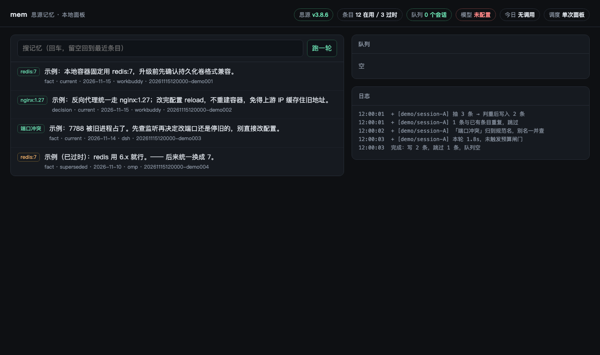

# siyuan-mem

把 agent 会话变成思源笔记里的记忆条目。

存储、索引、展示、双链、SQL 全是思源自己的，这个项目只补它没有的那一块：**采集、抽取、状态**。

## 为什么会有这个东西

我用过好几个 agent harness，每个都自带一点记忆：Claude Code 有 CLAUDE.md，Qoder 有自己的规则文件，dsh 能把上下文压成卡片。但它们各记各的，换个工具就得从头讲一遍「我们这个项目是怎么定的」。更烦的是那些记忆都是一坨文本——想知道「上次那个端口冲突最后怎么解决的」，只能翻聊天记录或者凭印象重问一遍。

于是想要一个自己的库：跨工具、能查、结论过期了能标出来而不是删掉。

一开始打算自己写全套。看了半天觉得不对——存储、索引、双向链接、SQL 查询、附件管理，这些思源已经做了十年，我重写一遍只会得到一个更差的版本。真正缺的只有一件事：**把会话日志里的结论抽出来，写进去**。

所以这个项目很小，边界也很硬：只负责采集、抽取、状态。剩下的都借。

## 它是怎么跑的

```
各 harness 会话日志 ┐
                    ├─▶ inbox ──mem serve──▶ 思源（Mem 笔记本）
其他机器的 mem push ─┘   ▲                      │
                        └── agent/pre-step 注入 ◀┘
```

三件事：

- **采集**：插件把用户说的话和模型说的话投进本地队列；`mem serve` 每十分钟扫一遍其余几家的日志补上。thinking、工具调用、自己注入的上下文全部丢掉。
- **抽取**：把一段会话压成几条带话题名的结论，写进思源，挂上状态属性。
- **注入**：开会话时查一次，把可能相关的既有结论贴进上下文。查不到就跳过，不阻塞对话。

## 安装

需要 Node **24+** 和 pnpm 12+（DSH 的会话日志是多帧 zstd，`zlib.zstdDecompressSync` 要 22.15 以上，仓库统一按 24 走），思源 3.8+ 在跑。

```bash
git clone <repo> ~/Codes/siyuan-mem && cd ~/Codes/siyuan-mem
cp config.example.json ~/.siyuan-mem/config.json   # 首次运行也会自动生成
node src/cli/cli.mjs init
```

`init` 会建一个 `Mem` 笔记本和三个文档：`01-条目`（当目录用，下面按月份分 `/2026-10`）、`02-实体`、`03-实体待确认`。

想直接敲 `mem`，从源码编一个自带运行时的单文件再软链进 PATH（npx 装的话直接用 `npx -p siyuan-mem mem`）：

```bash
pnpm dist                                     # 产物在 ~/.siyuan-mem/mem，86MB
ln -sf ~/.siyuan-mem/mem ~/.local/bin/mem
mem status
```

`~/.siyuan-mem/mem` 是**发版产物**，运行时焊死在里面（当前 bun 1.4.4）。改了代码要重新 `pnpm dist`，否则跑的还是旧的。

想抽取质量好一点，填 `config.json` 的 `model.apiKey`。不填也能跑，走规则抽取，只是结论糙——糙到什么程度：只取首段，写进库里是「让我为您重新推荐一些…」这种半句话。

## 命令

```bash
mem status                # 连通性、条目数、队列长度、召回健康度
mem serve                 # 常驻：找新会话 → 投队列 → 抽取 → 写思源
mem once                  # 手动跑一轮（--dry 先看要写什么）
mem search 端口冲突        # 查
mem search --all 端口冲突  # 连已过时的一起查
mem scan                  # 本机有哪些 harness 的会话，各多少
mem audit --all           # 对账：收了多少字、丢了多少字、为什么丢
mem review 20             # 最近 20 条，人工扫一眼
mem show <块id>            # 看这条结论对应的原文
mem remember "..." --entity 思源MCP --type fact
mem forget <#短引用…>      # 归档：标成不用的，不删、可撤销，默认检索看不到
mem forget --topic 打工人小账本 --yes   # 整个话题归档（超过 10 条先列清单，加 --yes 才写）
mem forget --list         # 看归档过什么（带短引用和原因）
mem forget --undo <#短引用…>            # 撤销归档，回到归档前的状态
mem entity                # 实体表
mem entity review         # 执行 03-实体待确认 里勾选的项
mem model list            # 内置 provider（可按关键词过滤）
mem ui                    # 本地面板 127.0.0.1:7787
mem service install       # 装成 launchd / systemd 服务
mem center setup          # 把本机设成中心（开接收端、生成 token）
mem push --to URL --token T --save   # 边缘机器：推到中心
```

## 一台机器，还是中心 + 边缘

单机时 `mem serve` 就够了，这节可以跳过。多机时要有中心，原则是：**思源在哪台机器上，mem 就装在哪台**。抽取要模型 key、要写同一份库，这两件事一分散，key 就有 N 份、prompt 就有 N 份、用量账就有 N 本。

```
边缘 A ─┐  mem push（本机日志 → turns，只推新增）
边缘 B ─┼──────────────▶  中心：mem serve
边缘 C ─┘                   ├─ 接收端 7788（token 鉴权 → 队列）
                            ├─ 抽取 + 写思源（唯一写入方）
                            └─ 面板 7787（只读，仅回环）
```

- **边缘只读日志、只发请求**：不碰模型、不碰思源，那台机器上只需要一个可执行文件和一个地址。
- **推送是增量的**：边缘按自己的 `push-offsets.json` 记「发到第几轮」，和 `mem serve` 的抽取进度分开存——共用一份的话，谁先跑谁把另一个的活儿吃掉（serve 处理过的会话 push 就当成已推，永远发不出去）。中心按内容哈希判重，边缘重装丢了游标会重推，但不会写两遍。
- **边缘别跑 `mem serve`**：抽取只有一个写入方，就是中心。边缘跑了就是同一批会话抽两遍，库里的条目对不上。

```bash
# 中心
mem center setup --port 7788      # 开接收端、生成 token、打印边缘要跑的那条命令
mem service install

# 边缘
mem push --to https://mem.example.com --token <token> --save --test
mem push --watch                  # 常态：活跃 15 分钟一轮，空转退到 30/60
mem push --once --all             # 首次回灌，不等安静 180 秒
```

几条必须知道的：

- **只推「安静了 3 分钟」的会话**。正在写的会话切出来全是半句话。`--quiet 0` 可以关掉。
- **token 必须有**。接收端是写入通道，没 token 又绑 `0.0.0.0` 会直接拒绝启动。公网走 HTTPS 反代；面板仍只绑 `127.0.0.1`，远程看用 `ssh -L 7787:127.0.0.1:7787`。模板里的中文占位符会被拒——复制一份模板不等于配好了 token。
- **容器不是 root 跑的**。镜像自带 `node` 用户（uid/gid 1000），数据卷属主要对上：`sudo chown -R 1000:1000 deploy/data`。
- **重建容器后要 reload 前面的 nginx**。`proxy_pass` 按容器名反代，但 nginx 只在自己启动时解析一次并缓存 IP，换 IP 之后公网全 502（容器内部是好的）。`docker exec nginx nginx -s reload` 就好。
- **思源在 Docker 里时，mem 装在宿主机**，`baseUrl` 填映射出来的端口。别把 mem 塞进思源容器：容器重建一次它就没了，而且它要读的是宿主机上的会话日志。
- **offsets 按机器分组**（`machines.<主机名>.<路径>`）。几台 Mac 的路径长得一模一样，不分开会互相顶掉。

## 数据结构

三个文档，各管一件事：

| 文档 | 放什么 | 谁写 |
|---|---|---|
| `01-条目` | 按「日期 · 项目」分二级标题，一条记忆一个列表项；标题上挂原文附件链接 | 抽取 |
| `02-实体` | 话题 → 条目摘要 → 块引用，纯视图，随时可重建 | `mem entity reindex` |
| `03-实体待确认` | 三态任务列表，人勾选 | 人 + worker 读 |

一条记忆 = 一个段落块 + 十二个属性：

| 属性 | 值 |
|---|---|
| `custom-mem-status` | `current` / `superseded` |
| `custom-mem-entity` | 话题（已归一） |
| `custom-mem-brief` | 三十字以内的结论摘要，`02-实体` 的锚文本用它 |
| `custom-mem-type` | `decision` / `fact` / `preference` / `reference` |
| `custom-mem-hash` | 内容哈希，去重用 |
| `custom-mem-source` | 哪个 harness 产生的 |
| `custom-mem-project` | 项目，从会话 cwd 推 |
| `custom-mem-session` | 会话 id |
| `custom-mem-date` | 写入日期 |
| `custom-mem-confidence` | 1–5 |
| `custom-mem-machine` | 哪台机器产生的 |
| `custom-mem-raw` | 原文指针 `assets/…jsonl#120-180` |

`project` 单独存一份，是因为分组标题只在文档里给人看、SQL 查不到，而「这个项目之前怎么定的」是召回里最常见的一类问题，靠关键词碰运气命中率很低。

状态只有两种，**过时不删**。「为什么当初不用 Oracle」的答案就藏在被取代的那条里。旧的会记 `superseded-by`，链是通的。

## 抽取：一个字都不截

采集侧不做任何截断。走到抽取的每一段都是用户真说的或模型真说的——那是唯一不可再生的语料，写的时候丢掉的东西，读的时候任何模型都救不回来。

长内容靠**拆批**，不靠砍：

- 按字符预算（默认 38000 字/次，约 24k token）切批，逐批**串行**调用。后一批会带上前面几批已抽出的条目（brief + 正文前 40 字），同一件事不会在批的接缝处再记一遍。只传话题名不够——模型知道「聊过网关」，但不知道「上次记的是白名单方案」，照样写第二遍。
- 一条问答本身超预算时按段落切开分送，所有段拼起来等于原文。
- 各批结果按内容去重后合并，超出单会话上限的条数会打出来，不静默丢弃。
- 会话内再走一次**语义收敛**：同一件事被前后几轮各总结一遍的，只留信息最全的那条。
- 模型调用失败退回规则抽取时，**原文留在队列里不归档**，等模型恢复重跑。

被过滤的只有四类，都不是对话内容：thinking、工具调用与结果、上下文压缩的摘要块（会伪装成用户消息）、插件自己注入的记忆。

实测：一个 1013 轮、26 万字符的会话 → 360 个问答对、17 批，字符数分毫不差。

| 配置 | 默认 | 作用 |
|---|---|---|
| `extract.maxCharsPerCall` | 38000 | 一次模型调用的字符预算（约 24k token） |
| `extract.maxEntriesPerBatch` | 18 | 每批最多出几条（超了算进 dropped，不静默丢） |
| `extract.maxEntriesPerSession` | 200 | 单会话上限。只留一道防跑飞闸门，不按批数压——超长会话往往就是最重要的项目会话 |
| `extract.minTurnChars` | 25 | 短于这个且两边都短的寒暄直接跳过 |

## 判重

入库前跟库里同话题的条目比一遍：`covered`（不写）、`replace`（写新的，旧的标 superseded）、`keep`（照写）。判重失败或拿不准一律照写——重复一条是脏，丢一条是错。

这一步只决定「把哪几条送去让模型判」，是不是重复始终由模型判断。**三条通道，命中任意一条就送，最多 10 条**：

| 通道 | 门槛 | 抓什么 |
|---|---|---|
| 同话题 | 字二元组覆盖率 ≥ 0.15 | 换个说法、详略不同 |
| 稀有词 | 全库出现 ≤3 次的英文/标识符词命中一个 | 同一件事被起了两个话题名 |
| 跨话题兜底 | 覆盖率 ≥ 0.28 | 整段中文、没有英文词可用时 |
| 同项目**兜底** | 覆盖率 ≥ 0.10，且上面凑不到 3 条 | 别的通道一条都挑不出来时才用 |

跨话题不能只看覆盖率。实测一对互相否定的结论（「是沙箱、无 sudo」vs「已移除沙箱、可用 sudo」）覆盖率只有 0.213，而全库完全不相干的条目也能到 0.18——中文共享的二字组太多。所以跨话题先看稀有词。

同项目那档只做兜底：一开始它是无条件开的，34 对真实数据上召回一条没多，平均候选却从 6.5 涨到 8.8、每条多花约 300 token。改成兜底之后成本回到 6.7 条。

**没用向量，是量过之后撤掉的**：

| 方案 | 召回（旧语料 82 查 / 179 处重复） | 召回（新语料 200 字口径） |
|---|---|---|
| 字面 6 条 | 87% | — |
| 字面 10 条 | 99% | 100% |
| 向量 10 条（bge-m3 嵌 brief） | 85% | 27% |
| 重排序（bge-reranker-v2-m3） | 判不了 | 判不了 |

结论两条：**收益全在「多给几个位置」上，不在「换成语义」上**（6 条提到 10 条，87%→99%，一次嵌入调用都不需要）；条目变长之后字面反而更强——200 字一条时同话题配对的余弦中位数只有 0.49，真重复和不相干的邻居挤在同一个区间。重排序更玄，重复对中位 0.999、不重复对 0.981，分布几乎完全重叠。

所以那套依赖（嵌入接口、本地向量表、`mem embed` 命令）整条移除了。将来真需要语义召回，先看这份数字再决定要不要加回来。

调门槛之前先跑评测，别凭感觉：

```bash
node scripts/eval-dedupe.mjs                 # 候选召回 + 成本
node scripts/eval-dedupe.mjs --no-project    # 消融：关掉同项目兜底
node scripts/eval-dedupe.mjs --with-model --batch 1   # 连模型裁决一起量（花钱、慢）
```

评测集不随仓库分发（由真实记忆正文构成），放在 `~/.siyuan-mem/eval/dedupe-pairs.json`。

**标负例必须读全文，不能看预览。** 这是踩过的坑：第一版按 120 字预览标，把 4 对「B 是 A 的超集」误标成负例——而判重的定义是「删掉其中一条不丢信息」，超集满足它，判 replace 本来就对。按预览标出来的「误判率」有三分之一是标注错误。

当前：34 对（21 正 / 13 负），候选召回 21/21，平均 6.4 条候选、约 900 token 一条；带模型 28/34。错的 6 个集中在两类——**指错对象**（判给了候选里另一条相关的）和**误合并**（旧条目有独有信息却判了 replace）。

攒久了还得体检。`node scripts/find-dups.mjs` 只找不改：同实体、较短那条被较长那条覆盖 ≥0.75。0.75 以上基本是同义改写，0.62–0.75 多半是同一件事的不同侧面（短文本覆盖率会虚高，实测一条 169 字的条目能跟六条不相干的都对上 0.69），那个区间必须人读一遍。

**比之前先剔掉正文里的原文指针。** 同一场会话的条目共用一长串 `原文 assets/mem-raw/…`，那串路径本身有几十个二元组，能把两条毫不相干的条目顶到 0.6 以上——第一版脚本报的 17 对里有 13 对是这么来的。这种假阳性比漏报更费时间，它让你以为库里脏了。

## 召回

```bash
mem search 车架
mem search "mcp adapter 元工具" --limit=5
mem search 索引 --topic=精简设计 --days=30
mem search 判重 --json
```

SQL 按 notebook + `custom-mem-status=current` 收口，拿回来按「词频 + 话题命中 + 日期新旧」排序。不走向量、也不走思源的 FTS 接口：中文短条目 `LIKE` 子串匹配本来就对；真正要过滤的 status/hash/entity 只在 `ial` 里，先 FTS 再回表多一跳；一千五百条扫一遍是毫秒级。

查询理解是分两阶段拆词的：

1. **ASCII 标识符整体保留**：`NO.2`、`node:22-alpine`、`etc/nginx.conf` 不被 `.`/`:`/`/` 切碎——它们是模型编不出来的硬锚，切碎就废了。
2. **连续汉字切 2-gram**：不需要分词器。不分词的话整句是一个词，SQL 要求整句连续出现，稍长的问法必然 0 命中。

SQL 只做 OR 粗筛，精确性交给内存里三道闸：

1. **`rel > 0`**：词真的落在正文/摘要/话题里，不是撞上原文路径。
2. **至少命中 N 个强词**：强词 = ASCII 标识符，或者「不是全部字都虚」的中文片段。虚词判定是**全部字都虚才算虚**，不是沾一个就算——按单字连坐会把「性能 / 时间 / 会议 / 上限」整批误杀，强词集一空，门槛就失效了。另有一张提问框架词表（`一次` / `需要` / `大概` / `多少`），它们不承载主题，不进门槛——不然「咖啡机多久除一次垢」会靠「需要 + 一次」命中一堆不相干的条目。门槛：有标识符时 1，否则 2。
3. **标识符必须在**：查 `nginx:1.27 的配置` 时，`nginx:1.25` 的条目能用「nginx + 配置」凑够两个词蒙过去，看起来像命中，答的却是另一个版本。误答比空手更糟，它看起来是答案。

按日期找要跨三层，少一层就等于没改：SQL 粗筛时日期词额外匹配 `custom-mem-date`（不然候选池里根本没那些条目）；内存里 `dateOk` 按段比数值而不是字符串前缀（库里补零存 `2026-01-15`，`startsWith("2026-1")` 会返回 11 月却漏掉 1 月）；日期**不算**强词，只当过滤器——否则任何一条今年记下的条目都能靠「2026」过闸。日期归一只有一处 `dateSegments`，SQL 拼串、内存比较、正文兜底都从它走。

**空结果要说清是哪种。** 以前 CLI 一律「没找到」、MCP 一律「没找到相关记忆」，可后端挂了也是这两句——把故障渲染成「没记过」比报错更糟，它看起来像答案。

| 情况 | CLI | MCP / 中心 | 面板 |
|---|---|---|---|
| 真的查过没有（`no-match`） | 「没找到。检索词：…」，退出码 0 | 「没找到相关记忆」 | 「没有命中」 |
| 没问出词（`no-terms` / `no-meaningful-terms`） | 「这句话里没有能定位的词，换个说法」 | 同左 | 同左 |
| 后端故障（`backend-error` / `sql-not-array`） | 「检索失败：…，这不代表没记过」，**退出码 1** | `isError: true`；中心回 503 | 回 503，列表里显示错误 |

`mem status` 的召回行也按这个分桶：空手只数真的查过没有的，后端失败和没问出词单列。不然「要不要继续调召回」这个判断就被故障灌水了。

### 评测到现在的位置

题库 81 条，覆盖四类条目、2026-05 到 2026-11 的时间跨度，问法含定义、数量、方法、是非、原因、对比六种，另留了短查询和中英混合。每题「整句 / 关键词」两种问法，`--limit 5` 算命中。

按 `--limit 5`：

| 档位 | 题数 | 整句 | 关键词 |
|---|---|---|---|
| 简单（有原词） | 23 | 100% | 91% |
| 中等（换说法） | 33 | 91% | 100% |
| 困难（无原词） | 14 | 50% | 100% |
| 负例（不该命中） | 11 | 100% | — |
| 正例合计 | 70 | 86% | 97% |

三条经验，都是踩出来的：

- **题库要按条目正文出题，出完再跑评测**，不能反过来「看算法召回什么就出什么题」——那是自证。同理，标负例要读全文，别读预览。
- **每题只认一个 id 会让尺子本身有误差。** 同一个问题在库里常有多条都答得上，算法返回其中任何一条都被判没命中，于是这些题被误归成「排序问题」。逐条读候选正文、把确实回答了问题的 id 补进 expect 之后，整句从 83% 涨到 86%、排序遗留从 7 条降到 3 条——**算法一个字没改**，涨的是尺子。跟历史数字比之前先看口径。
- **负例掉了先查语料污染，再怀疑算法。** 中间负例从 100% 掉到 80%，不是回归：复盘正文把测试用的示例词原样列了一遍，于是它们真的存在库里，任何含这些串的查询都会撞上。清掉之后又冒出两条，原因一样。现在抽取提示词里有一条常驻规则：复盘里不逐字抄示例词，用「某个型号」代替。

排序也量过了，没空间：162 组参数扫描里护栏全过且负例全绿的只有 18 套，最好的也只是把摘要权重从 3 提到 5，整句 81%→83%、MRR 0.69→0.71。这点收益在噪声量级，写出来只是说明「别再调权重了」。护栏是两条刻意留的区分——新而简短的必须压过旧但啰嗦的、把一件事说透了的旧条目仍能翻盘——破任一条的方案数字再漂亮也不收。

评测脚本遇到后端故障会直接中止（退出码 2），不产出基线表。故障时每条查询都空手，跑出来是一张 0% 的表，看起来像「算法全面回归」，然后人就跑去调一个没坏的算法。宁可没有数字，也不要一张假的数字。

## MCP：三个工具

```bash
# 独立入口，只走中心。装在「有 harness、没思源」的机器上
npx -y -p siyuan-mem mem-mcp --to https://… --token …

# 同一个包里的子命令；不填 --to 就直连本机思源
mem mcp
```

`mem-mcp` 只认中心，因为它装的那台机器上没有思源：让它试本地只会超时，而超时的表现是「每次都查不到」，看起来像记忆库是空的。地址和 token 不填就读配置里的 `push.to` / `push.token`。

| 工具 | 干什么 | 什么时候用 |
|---|---|---|
| `memory_search` | **默认入口**。一句话 → 最相关的几条 | 知道要找什么词 |
| `memory_topics` | 列话题名 + 别名 + 每个话题多少条 + 最近更新 | 不确定话题叫什么、search 没命中、用户问「都记了些什么」 |
| `memory_entries` | 按话题逐条翻，不走关键词门槛，按日期倒序 | 知道话题名、想看这个话题下都记了什么 |
| `memory_archive` | 归档（唯一的写工具）：按短引用 / 话题 / 会话，可撤销 | 用户明说某条「记错了 / 没用 / 只是试试」 |

一开始只有一个 `memory_search`。它其实一直有 `topic` 参数、还走别名解析，但 agent 不知道库里有哪些话题、该填哪个名字，只能靠猜关键词。加两个导航工具补的是这个——把话题从排序信号升级成能主动浏览的维度。

借了 mcp-adapter 的几条约定（它是把 410 个工具收敛成 4 个元工具治上下文膨胀，我们反过来从 1 个展开成 3 个治命名空间不可见，骨架都是渐进披露）：

- **路由写进工具 description**，每个描述都点名下一步该换哪个工具。这比指望 harness 的系统提示词稳——每个客户端拿到 `tools/list` 就自带路由说明。
- **结果带匹配依据和下一步**：目录标 `[名字命中]` / `[别名命中]` / `[兜底浏览]`，条目结果会说「「k8s」已归到规范名「Kubernetes」」。
- **参数是 hint 不是硬过滤**：`q` 没匹配到任何话题时，返回最活跃的几个兜底浏览并说明「这不是你要的」；`topic` 没解析到时给候选名，不静默返回空。
- **空结果分层兜底**：目录空 → 指向 `memory_search` 和 `mem status`；话题没对上 → 候选名；话题对上但没内容 → 提示放宽 `days`。
- **严格控量**：话题默认 20 上限 50、条目默认 8 上限 20，正文截断 400 字，超量时明说还有多少。真实库有 200 多个话题，「全列出来」就是新的上下文炸弹。
- **失败分类**：后端故障一律 `isError` + 「这不代表没记过」，实体表读不出来标 `degraded` 并说明别名没归并。

导航在 `src/core/browse.mjs`，**不碰 `search.mjs` 的三道闸**：那边要求 `rel>0`、强词够数、标识符在；这边用户已明确指定话题，再套词匹配只会把该看到的藏起来。名字归并复用 `entities.mjs` 的 `topicNames`，不另写一套。

中心和边缘一起打通：`/api/topics`、`/api/entries` 与 `/api/search` 共用端口和 token。导航调用单独记 `memory.browse` 事件，不混进 `memory.hit/miss`——那是召回率的分母。`mem status` 单列一行「导航」，是判断新工具到底有没有被用起来的唯一信号。

注册到 Claude Code：

```bash
claude mcp add siyuan-mem -- npx -y -p siyuan-mem mem-mcp --to https://中心地址 --token $TOKEN
```

装上只是「能调」，不等于「会调」。CLAUDE.md 里补一句什么时候该查，比指望模型自觉靠谱：

> 遇到「之前这个是怎么定的」「上次踩过什么坑」「这个项目用过哪些方案」，先调 `memory_search` 再回答；查不到就是真的没记过，别编。不确定话题叫什么就先 `memory_topics` 看目录，再用 `memory_entries` 翻。

### 归档：噪音不用在抽取阶段处理

抽出来的东西有一部分注定是噪音——当时随手试的功能、被打断就再没接着聊的话题。这类内容**不该在抽取时过滤**：那一步手里只有文本，没有任何用户反馈，让模型判断「这是噪音」等于让它猜，猜错的代价是永久丢内容，而且事后查不出「为什么没记」。

所以它是事后动作：用户说「这个没用 / 过时了 / 当时只是试试」，agent 调 `memory_archive` 把它标成 `archived`。块不删、原文指针不动，只改属性，随时能撤销。

三个状态各管一件事，不能合并：`current` 在用、`superseded` 被新结论取代（查「当初为什么改」时还要能翻出来）、`archived` 用户主动丢掉的噪音（默认任何查询都看不到，只有显式 `status=archived` 才看）。混成一个状态，「为什么改」这类查询会被试用记录淹掉，`mem status` 的计数也失去意义。

两条刹车，因为这是模型第一次拿到会改数据的工具：

- **整话题 / 整会话超过 10 条先回预览**，确认了才写。用户说「这条没用」时，模型很容易顺手把整个话题清空。
- **单条必须点名**：命中行末尾带块 id 的末 7 位（`#abc1234`），归档时按它解析，撞车就报歧义而不是挑一条。

撤销要回到归档前的状态（`custom-mem-prior-status`）：一条本来就被取代的条目，撤销成 `current` 等于把旧结论复活。

### 回流：agent 读过库之后写的总结

让 agent「翻一遍 mem 再写总结」会形成一个回路：它读的是库里的条目，写出来的东西又会被抽取回去。这条路没有想象中直——采集层 `cleanContent` 只取文本块，**工具结果整块丢掉**，那几十条正文从来没进过语料；能回流的只有它自己写的那段话，是改写和综合，不是原文复制。

为了知道这件事到底有多大，采集时会统计一场会话调用过几次我们自己的 MCP 工具（`memory_search` / `memory_topics` / `memory_entries` / `memory_archive`），随 payload 推给中心，落进 `session.begin` 事件。`mem status` 里多一行：

```
回流         2/9 场会话调用过 mem 工具（共 7 次），抽出来的可能是二手复述
```

**只统计，不拦截。** 现在没有证据说明这类会话一定产生重复条目（判重本来就该挡掉改写式复述），一场都没有的时候就加拦截，只能在误伤正常会话和漏掉大半之间瞎猜。等比例清楚了再决定是整场跳过（`session.skip: derived`，可 `--force`）还是只打标降权。

已有的兜底是归档：真出现了「关于某系统的总结」这类二手条目，`mem forget --topic` 一次收掉，块和原文都不删。

### 导航到底有没有用

81 题题库是单跳（一句 query → 一个期望 id），量不了「一个任务 → 一串工具调用 → 最终答案」。`scripts/eval-tasks.mjs` 补这一层，记录整条调用链：每步调了什么、返回了什么、期望条目有没有被摆到模型眼前、一共往上下文塞了多少字符。

两条防自证的规矩：链路里不许偷看 expect（LLM 策略里模型只看问题 + 话题名字，看不到正文和答案），测的是「可达性」不是「答案对不对」。

14 道困难题，两种策略对照：

| 策略 | 单跳命中 | 导航可达 | 靠导航翻到 | 平均调用 | 平均字符 |
|---|---|---|---|---|---|
| mechanical（零模型，2-gram 查目录） | 7/14 | 50% | 0 题 | 4.6 | 6071 |
| llm（模型看目录挑话题） | 7/14 | **71%** | **3 题** | 5.1 | 13531 |

机械链路一题都没救回来，9/14 的目录查询一次都没真匹配上——「为什/什么/么服」这种 2-gram 本来就查不到话题「端口冲突」。**它的阴性比阳性可信**：连零模型的链路都够不到，说明缺口在「从问题猜话题名」，不是排序或权重。

模型补上这一步之后救回 3 题，逐条读过正文，确实答得上。分因也查清楚了：答案话题 11/14 在前 50 目录里，话题选对之后 13/14 翻 20 条就能看到期望条目——**导航层本身是通的**。够不到的 4 题里 3 题是模型挑了语义相近的邻居，1 题答案话题排在目录第 153 名，前 50 根本没给到。

顺手做了两个对照，都是否定结果：把完整 213 个话题名全给模型，可达反而从 3 掉到 2；允许挑 5 个也还是 2。给更多候选会稀释判断力，所以不放宽 `TOPIC_LIMIT.max=50`。

代价记清楚：llm 策略平均 5.1 次调用、13k 字符进上下文，是机械链路的两倍多，还没算模型挑话题那一次。可达也不等于模型会读、会认，更不等于答案对了。

## 原文归档

结论要能追回原话。存法是思源附件，不是笔记正文：

- 附件不进 `blocks_fts`。正文里的对话会把关键词的 IDF 稀释掉——搜结论时先蹦出一堆「你说的是那个端口吗」，这就是原文进正文的代价。
- 代价是附件会被「清理未引用资源」扫到。所以每个 part 都必须在某个块的正文里被链接一次——`01-条目` 的分组标题就是那个锚点，那不是装饰，是保活用的。
- 存**规范化后的轮次**，不是原始日志：227MB 变 7.5MB，差 30 倍。差额是 thinking、工具调用、注入的上下文，本来就不进记忆。

格式是 JSONL，一行一轮，首行 meta：

```
{"type":"session","v":1,"machine":"laptop","harness":"dsh","session":"…","from":1,"to":180,"chars":61234,"hash":"…"}
{"i":1,"role":"user","text":"…"}
{"i":2,"role":"assistant","text":"…"}
```

选它的理由只有一个：**行就是地址**。第 120 轮到第 180 轮顺序读过去就停，不用解析全文；坏一行不连累别的；`grep` 直接命中。md 做不到——没有稳定行地址，想找第 120 轮只能整份解析。

指针长这样：

```
custom-mem-raw = "assets/mem-raw/laptop/dsh/s.p1-20260101000000-aaaaaaa.jsonl#120-180"
```

物理路径 + 轮次范围。不用「块 id + 逻辑轮次」，因为物理路径指向一个写进去就不再变的文件：日志被重写、重新切分、附件改名，都不会让指针错位。轮次号按每行的 `i` 字段比，不按行号。

附件不能追加，所以长会话按**推送批次**切成多个 part，一个 part 一个新文件，永不重写。单包超过 8MB 会在轮次边界再切，绝不切一行。传一半失败可以续：切分只跟 turns 和字节预算有关，重试会切出一模一样的分段，已经传过的直接跳过。

「哪些区间传过」只记在本地 `raw-index.json`。以前还有一条回思源查 `custom-mem-kind="raw-part"` 块的兜底，但那种块早就不写了，那条路永远返回空，`mem raw list` 因此一直显示「还没有归档过原文」。**一条永远返回空的兜底比没有更坏**，它让「索引丢了也能恢复」变成错觉。现在兜底删了、命令改读索引。代价是索引丢了就不知道传过什么，下次增量会重传——附件不覆盖，只多出重复文件，不丢内容但会脏。

`mem show <块id>` 读指针、取回附件、只渲染那几十轮，默认截到 8000 字。

**指针收窄是实验性的，默认关闭。** 抽取是「一批一次模型调用」，那批抽出来的几条结论共用同一个 `from/to`，一批常横跨几十轮、三万多字，点开等于没指。`narrowAnchor` 能用结论里那些硬锚（文件名、参数名、端口、报错串）落回原文行，把范围收窄到真出处的连续几行。

但抽检发现随机 20 条已收窄条目里 3–4 条指偏（结论讲 A、窗口落在 B），专挑极端样本时到 40%。而**收窄错了比宽更糟**：宽了只是多读几行，指偏是给人一条看似精确、实则无关的出处，还看不出来。所以存量已全量回滚、新写入默认不收窄，`scripts/retighten.mjs` 冻结不再投入。真要精确出处，下一步该让抽取阶段直接产出轮次指针，而不是事后猜。

## 话题归一

模型给的 entity 是自由的，同一个东西会变成「redis:7」「redis 7」「docker.io/redis:7」。检索取的是 entity 字段，名字一散，查一个漏两个。

三道闸，从便宜到贵：

1. **抽取时带清单**：把已有实体（连同别名）塞进 prompt，让模型优先复用。几百个实体三千 token，一批多花这点钱换源头不产生新名字。
2. **本地字符串匹配**：包含关系、编辑距离、最长公共子串。零成本，吃掉绝大多数变体。
3. **弱候选问一次模型**：只回答下标 `{"same":[0,3]}`，一次判二三十对；判过 diff 的记进否定表，以后不再问。

**后缀不自动合并。** `redis:7` 和 `redis:7-alpine` 字面上只差几个字符，但那是两个不同的镜像；同理 `vite` 和 `vite-plugin-x` 也不是一回事。这类进 `03-实体待确认` 让人看一眼。

话题名必须是**名词短语，2-6 字**，不是句子、不是疑问、不是状态。这条是量出来的：同一场 20 轮会话连抽两遍，内容层 6 条里 6 条能对上，但话题名交集 3、并集 9——同一件事两遍给出三个名字。名字散一次，实体表多两行，检索入口裂成三个，判重候选也跟着变多。把规则写进 prompt 并配正反例之后，复测并集 9 → 5，三遍里两遍完全一致。压下去了，但没归零。

**话题收敛每轮跑一次**：把全部话题名连同各话题下两三条摘要交给模型，问哪些该合并。吃过一次严重误合的亏——具体项目被并进了它所在的生态，68 条实现细节全躺在叫「生态」的桶里。根因在 prompt：写着「宁可多合一点」，而且只给名字不给内容。现在三条规矩：判据是「把两个名字分别填进『我要查 ___ 怎么做的』」；名字后面挂两三条摘要当证据；拿不准就不合，合并是单向的，错合之后没人知道当初为什么合。

收敛只管名字，不管内容。如果一个话题的桶里装的其实是另一个东西，该做的是把条目的 `custom-mem-entity` 改挂过去，不是合并两个名字。

### 待确认是显式三态

思源只有 `[ ]` 和 `[X]`（`[x]` 会被存成大写），**没有打叉**。所以否定必须写出来，不能靠「不勾」或「删行」推断——那样三天后你自己也分不清是判过了还是没处理。

```markdown
## 待确认

- [ ] redis:7-alpine ← redis:7    ← 不动 = 继续待确认

## 已否定
```

`[X]` = 合并，`[-]` = 不是同一个（写进否定表，以后不再问）。整行无论怎么写，解析按块 id 定位，不按行号。勾选之后的合并是纯机械操作，不调模型——你勾的时候已经做完判断了。

## 五家 harness，一份读取器

核心（抽取、存储、查询、状态）跟 harness 无关，一行没绑定。绑不住的只有「怎么拿到会话」。

| harness | 会话日志 | 接法 | 限制 |
|---|---|---|---|
| WorkBuddy | `~/.workbuddy/projects/*/*.jsonl` | 读日志 | 闭源，拿不到进程内事件 |
| Qoder | `~/.qoder/projects/*/*.jsonl` | 读日志 | 格式照抄 Claude Code |
| OMP | `~/.omp/agent/sessions/*/*.jsonl` | 读日志 | 子代理转录在会话目录下一层，要跳过 |
| DSH | `~/.dsh/sessions/*/*/session.v4.jsonl.zstd` | cordis 插件，或读日志兜底 | 多帧 zstd |
| Claude Code | `~/.claude/projects/*/*.jsonl` | hook 脚本，或读日志 | 子代理标 `isSidechain` |

读取分两层：**共用引擎 + 每家一份声明**。`readers/base.mjs` 是引擎（解压、找消息节点、role 归一、注入块、子代理回报、逐块对账），`readers/<harness>.mjs` 只声明差异，每个十几到几十行。为什么不全塞进一个通用函数？试过，四家在 105 个会话上逐字节一致，但那是「读文本」一致；各家特有的过滤规则混进共用代码之后，改一家的规则会波及另外三家。

格式细节和各家的坑在 [`docs/harness-会话格式横向对比.md`](docs/harness-会话格式横向对比.md)。

日志这条路还有个附带好处：插件截获会漏、会崩、会重复，日志是 append-only 的，harness 自己不会写丢。插件挂了，日志还在。

```bash
mem ingest-log ~/.workbuddy/projects/<ws>/<session>.jsonl
mem ingest-log ~/.dsh/sessions/<ws>/<sid>/session.v4.jsonl.zstd
```

**子代理要分两半看**：它自己的转录整份不读，但它的**结论**会回到主线（OMP 是 `job` 工具结果里的 `<task-result>`，Claude Code 是 `Task` 的 `tool_result`）——这一份必须收，否则丢的是结论。本机这样捞回 64 段、12.3 万字。

剔掉的不等于丢掉了：`mem audit` 会把每个块归到「收进语料 / 思考块 / 工具结果 / 注入与摘要 / 其它」，五类相加等于日志里全部消息文字。本机 105 个会话对账，2585 万字里 355 万进语料，「其它」为 0。

## DSH 插件

`plugin/` 是个 cordis 插件，装到 profile 里：

```bash
cd ~/Codes/siyuan-mem/plugin && npm link
dsh plugin --profile desktop add dsh-siyuan-memory
dsh --profile desktop --dump-config   # 确认它出现在配置树里
```

它只做两件事：`session/event` 攒文本、`session/flush` 写队列；`agent/pre-step` 注入一次。没有界面、没有右键菜单——远程和 headless 的会话一视同仁。思源没开也安全：注入超时 800ms 就放弃，采集只写本地文件。

## 常驻：锁、节奏、退避、闸门

`mem serve` 就是「每十分钟自己跑一轮」，但只写个定时循环会踩坑，所以它多做几件事。

**锁。** 思源没有行级合并，两个进程同时写同一份文档，后写的整块覆盖先写的。锁用 `O_EXCL` 建文件，靠内核保证只有一个进程能建成，不靠「先查再写」那种有竞态的判断。持锁进程被 `kill -9` 时锁会留在磁盘上，所以启动时先看 `process.kill(pid, 0)`：进程不在了就接管，还在就报错退出。

**节奏。** 正在写的会话不能切：每十分钟切一刀，切出来全是半句话。所以只投「安静了 180 秒」的会话。另外只读**体积变过**的文件——本机 105 个会话共 500MB，每轮全解析纯属浪费，而 `stat` 是微秒级的。

**退避。** 思源没开、模型 429 的时候不要连着重试。失败后第一次等 1 分钟，之后翻倍，最多 30 分钟；成功一次归零。一轮的顺序也是固定的：先探思源活着没有，再看有没有新会话，最后才调模型——反过来，思源一天没开，模型的钱就白花一天。

**闸门。** 轮预算只在会话之间检查，所以只要一场会话自己跑得久，一轮就能跑到天亮。我这台 2G 的服务器上真死过一次：预算写的是 20 分钟，实际跑了 103 分钟，swap 吃满把 load 顶到 120，SSH 连 banner 都吐不出来。所以现在有四层：

| 配置 | 默认 | 作用 |
|---|---|---|
| `serve.maxMinutesPerRound` | 20 | 一轮的墙钟上限，会话之间检查 |
| `serve.maxMinutesPerSession` | 10 | 单场会话内部的上限 |
| `serve.maxConsecutiveFailures` | 3 | 写库连着失败就熔断本轮，不再一条条撞超时 |
| `serve.maxAttemptsPerSession` | 3 | 试满三次进死信，别一直压着队头 |

单会话那道上限盖住两段。写库那段到点停手，已写的留着（下轮按 hash 判重跳过）；抽取那段到点就不再发下一批模型调用，已经抽出来的照常写库，**已经抽过的轮次从队列摘掉**，剩下的下轮接着抽。后半条是必须的——一场几百轮的会话能拆十几批，一批一次调用、最长见过 254 秒，每轮都从头重抽的话永远走不到后半段。

熔断时整轮立刻停手、队列原样保留，不记在会话头上——一次思源故障不该把所有会话都记成「有问题的」。真正的老赖挪进 `~/.siyuan-mem/dead/`，旁边留一份 `.why` 写原因；修好后 `mv` 回 `inbox/` 就能重跑。

**单飞。** 进程锁挡的是第二个进程，挡不住同一个进程里的两条流。面板上点「跑一轮」和定时轮走两个入口，各跑各的 `processQueue`，会同时往同一批块上 append——思源没有行级合并，撞上去不报错，只表现为「偶尔有条目写了一半」。所以 `serve` 里加了一道进程内互斥，后来者拿 409。

日志在 `~/.siyuan-mem/serve.log`，超过 2MB 轮转，每轮一行：

```
2026-10-29 15:06:40  第 1 轮 4.0s：思源 v3.8.6，扫描 105 个会话，新投 2 个（697 轮），写入 33 条，跳过 0，失败 0
```

## 服务与面板

```bash
mem service            # 状态：plist 在不在、launchctl 里有没有、最近一行日志
mem service install    # 常驻（KeepAlive，崩溃后 30 秒重试）
mem service uninstall
mem service unit       # Linux：打印 systemd 单元，不落盘
```

plist 里的可执行文件优先指向 `~/.siyuan-mem/mem`，其次退回 node shim。**不要信 `which node`**——它只反映当前 shell 的 PATH，而 launchd 的 PATH 只有 `/usr/bin:/bin:/usr/sbin:/sbin`。

两个坑代码里处理了：`launchctl load` 装失败也返回 0（只在 stderr 打一句 `Load failed: 5`），所以装完必须回查 `launchctl print`；配置错的时候 `serve` 会干净退出（exit 0），KeepAlive 只对失败重启，所以不会热循环。

面板在 `127.0.0.1:7787`（`mem ui` 可以单独开）：看状态、翻最近条目、看队列和日志尾部，点一下能跑一轮。



只有 127.0.0.1，**没有鉴权**，所以绝不绑 `0.0.0.0`——局域网上任何设备都能读你的记忆库。只绑回环还挡不住 DNS rebinding（攻击者把恶意域名解析到 127.0.0.1，你打开那个页面，脚本 `fetch` 就到了这里），所以每个请求的 `Host` 也校验，不对直接 403。

### 单文件二进制（可选）

```bash
pnpm dist         # 打包 → 对账 → 装到 ~/.siyuan-mem/mem
```

`dist` 不只编译，还要**自证**：产物跑一遍 `audit --all`，跟 node 的结果逐字比对，对不上就不落盘。理由是 bun 的 `node:zlib`、`node:fs` 是重实现，我被「`zstdDecompressSync` 只解第一帧、1MB 解出 243 字节还不报错」坑过一次——静默吞掉半段语料比直接崩更难查。

实测（bun 1.4.4）：106 个会话、368 万字，node 与产物的 `audit --all` 逐字一致，逐会话 sha256 也一致（含多帧 zstd）。产物 85MB，启动 30ms。代价是运行时焊死在里面，升级 bun 之后必须重打。

## 日志：两份，各管一件事

`serve.log` 给人看，按体积轮转，只记「这一轮写了多少条」。调参和回溯靠不住它——想知道某条为什么没写、判重判成了什么，得看结构化那份。

`~/.siyuan-mem/logs/<日期>.jsonl` 一行一个事件，按天分文件，保留 30 天：

| 事件 | 什么时候写 | 关键字段 |
|---|---|---|
| `round` | 每轮巡检结束 | `scanned/enqueued/written/skipped/failed/tokens/ms` |
| `session.begin` / `session.skip` | 开始 / 跳过一场会话 | `session/harness/turns`、`reason` |
| `extract.result` | 抽取结束 | `mode/entries/merged/dropped/tokens/ms/model/prompt` |
| `dedupe.decision` | 每条被判重的条目 | `action`（covered/replace）/`target` |
| `entry.write` / `entry.skip` / `entry.replace` | 写 / 没写 / 顶掉旧条目 | `id/entity/len`、`reason`、`old/new` |
| `memory.hit` / `memory.miss` | 一次检索命中 / 空手 | `source/reason/topics/n` |
| `memory.browse` | 一次导航 | `kind/source/total/shown` |
| `error` | 任一环节异常 | `where/message` |

`model` 和 `prompt` 每次都记：prompt 的指纹是模板内容的 sha1 前八位，换一个字就变。没有这个，两周后看到「条目突然从 22 条变 36 条」根本分不清是模型抽风还是自己改过提示词。

```bash
mem log stats [--days 7]     # 汇总：写了多少、拦了多少、错几次、长度分位
mem log tail [-n 20]         # 今天最近的事件
mem log grep <关键词>         # 在字段里搜
```

日志里不记正文，只记 id 和长度。正文在思源里，日志带全文会变成第二个没治理的记忆库，也不利于隐私。

## 已经踩过的坑

都是实测撞出来的，改代码时注意别踩回去。

**思源的块 id 不能用 `path` 查。** `path` 是 `/20260101000000-aaaaaaa.sy` 这种内部路径，中文名只在 `hpath` 里。用 `path` 查永远空，于是每次 init 都新建一份同名文档——十几分钟能堆出六十个。

**SQL 索引是异步的。** 刚写完的块立刻查不到，几秒后才出现。所以去重靠内容哈希 + 进程内 Set，`init` 解析出的 id 缓存在本地，不每次回查。

**`appendBlock` 返回的不是 id**，是 `[{doOperations:[{action:"insert",id:"..."}]}]`。当字符串用会静默变 undefined，错在后面的 `setBlockAttrs` 才报。而且往列表块里插 `- xxx` 时返回的是临时 id（落库后查不到），往列表项插纯段落时才是真的——要可靠 id 只能 `getChildBlocks` 再取一次。

**建块和设属性不是一次事务。** 属性没写成，块就成了孤儿：查不到、审不到、去重也挡不住。写入失败要补偿删除。

**状态缓存的键要带笔记本名。** 只按 `baseUrl` 存的话，把 config 里的 `notebook` 改成测试笔记本之后，`init` 命中缓存，33 条测试数据直接写进了正式笔记本。现在键是 `baseUrl#笔记本名`，缓存命中时还要按 `blocks.box` 验一次归属。

**`createNotebook` 返回 `data.notebook.id`**；聚合列别叫 `current`（SQL 关键字）；删除文档要用 `filetree/removeDocByID`，`block/deleteBlock` 对它无效。

**从 `blocks` 表按名字猜笔记本 id 是错的。** `type='b'` 是引用块不是笔记本，笔记本 id 只有一个可靠来源：`/api/notebook/lsNotebooks`。

**删块只能按精确 id，绝不按内容关键字扫。** 清理测试条目时我写了一句 `content like '%冒烟%'` 然后逐个 deleteBlock，它没限 `box`、没限 `root_id`，结果扫出两篇手写笔记里的块，删掉 9 个。教训两条：任何写操作（尤其删除）的 where 必须同时限定 `box` 和 `root_id`；删除前的候选必须打印「文档标题」给人看，只打内容片段看不出它属于哪篇。事后靠思源的 `history/` 快照恢复了内容，但块 id 变了。

**跑完一轮不等于写完盘。** `.sy` 是延迟落盘的，删除之后立刻读磁盘还是旧内容；反过来磁盘上有也不等于内核里还有。判断块在不在只能查 `blocks` 表。

**同一件事在两处实现，迟早会分叉。** 检索原来有两份：面板用的和 CLI 用的。后者有打分、有记账、按 `box` 收口；前者什么都没有，还不按笔记本限定。现在只留一份。

## 还没做

- fs.watch 即时触发。现在最慢的路径是：静默 3 分钟 + 推送 ≤15 分钟 + 中心一轮 ≤10 分钟
- **MCP 还没挂到每个 harness 上**：三个工具都能用，但这台机器只接了 Claude Code 的注册说明；dsh / omp / qoder 的配置片段还没写。`mem status` 里 `mcp` 来源的命中至今为 0
- **任务级评测集没建**：困难档 14 题试跑过（可达 50%→71%），确认链路有效、瓶颈在「问题 → 话题名」的语义映射。要变成常驻指标，得固定任务级问法并明确「最终答案对了」的判据
- 冷热分层：`memory.hit` 已经在记，但「沉睡 / 归档」的判定和复审清单没做
- 长会话中途分段 flush：现在只在会话结束时抽一次
- 多用户隔离：现在假设单用户单 workspace，代码里没有 tenant 维度
- 原文索引丢了只能重传（不丢内容，但会多出重复附件）

## 目录

```
src/
  cli/                装在被采集的那台机器上
    cli.mjs           命令入口（bin: mem）
    push.mjs          读本机日志 → 推给中心
    service.mjs       装成 launchd / systemd 服务
  core/               装在思源那台机器上
    serve.mjs         常驻循环（扫描 → 入队 → 抽取 → 写库）
    ingest.mjs        接收端 HTTP（/api/ingest、/api/search、/api/topics、/api/entries）
    jobs.mjs          一轮的编排：分批、判重、收敛、写条目、原文保活
    extract.mjs       抽取（prompt + schema）
    dedupe.mjs        判重：候选挑选 + 模型裁决
    entities.mjs      话题归一：别名、合并、待确认
    store.mjs         写思源（块、属性、文档结构）
    search.mjs        检索（SQL + 打分）
    browse.mjs        导航：列话题 / 按话题翻条目
    prompt.mjs        提示词外置、版本、备份
    inbox.mjs         队列
    repair.mjs        补偿账本
  mcp/                给 harness 调（只读）
    server.mjs        协议实现（stdio，三个工具）
    main.mjs          独立入口（bin: mem-mcp），只走中心
  util/               三边共用
    config.mjs        配置读写（默认值合并、0600）
    siyuan.mjs        思源 API 客户端
    llm.mjs           模型调用：schema 强制、重试、降级、记账
    log.mjs           结构化事件日志
    raw.mjs           原文归档与指针
    remote.mjs        中心的三个只读接口客户端
    readers/          五家 harness 各一份声明 + 共用引擎
```

三条边界：**core** 调模型、写思源；**cli** 只搬运；**mcp** 只读。三者共用 `util/`。

测试：`pnpm test`，308 项，全部是纯函数或假服务端——不连真思源、不真调模型。

发版不改 `package.json` 的版本号：那里是 `0.0.0-development` 占位符，真正的版本由 Release 的 tag（`v0.1.1` 这种）决定。push 代码后在 GitHub 建一个 `v<版本>` 的 Release，workflow 会把 tag 的版本临时写进发布副本、跑完测试再发到 npm，仓库里永远是占位符——不回写、不额外提交，也不会二次触发自己。前提是先去 npmjs.com 的包设置里配好 Trusted Publisher（GitHub Actions，owner `Lancernix`、repo `siyuan-mem`、workflow `publish.yml`、环境留空），配完之后 CI 不需要任何 npm token。

想跳过网页，也可以在 Actions 页手动跑 `Publish to npm`，填一个版本号。
